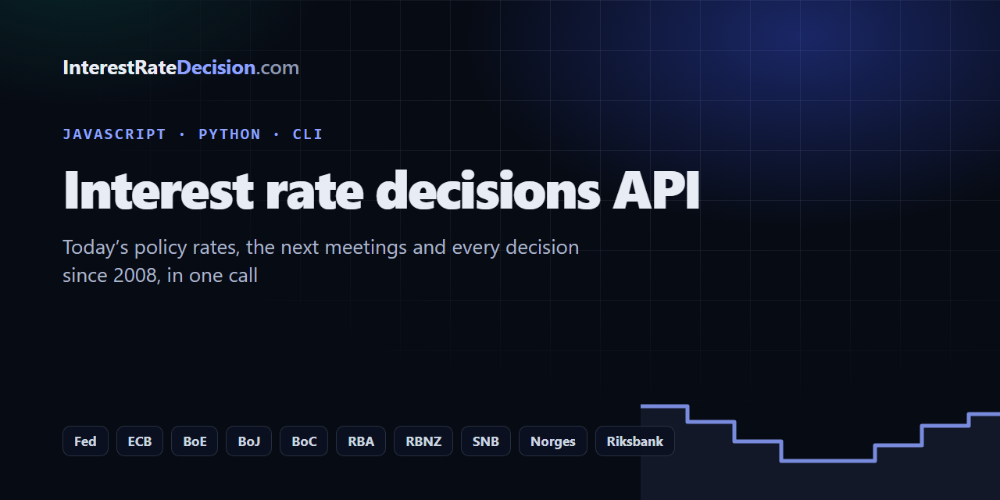

# Interest Rate Decisions API for JavaScript and Python

[](https://interestratedecision.com/central-bank-data/)

[](https://www.npmjs.com/package/interest-rate-decisions)
[](https://pypi.org/project/interest-rate-decisions/)
[](#)
[](LICENSE)

**Central bank interest rates and decisions in one call**: today's policy rates, the next central bank meetings, and every rate decision since 2008 for the Federal Reserve (FOMC), European Central Bank, Bank of England, Bank of Japan, Bank of Canada, RBA, RBNZ, Swiss National Bank, Norges Bank and Sveriges Riksbank. A free alternative to paid economic calendar APIs for the decisions themselves, with no key and no sign-up.

Data from **[InterestRateDecision.com](https://interestratedecision.com/)**, updated within minutes of each decision.

```sh
npx interest-rate-decisions        # the next central bank decisions and every policy rate, in your terminal
npx interest-rate-decisions fed    # just the Fed
```

## Contents

- [JavaScript and TypeScript](#javascript-and-typescript)
- [Python](#python)
- [What you get](#what-you-get)
- [Common questions](#common-questions)

## JavaScript and TypeScript

```sh
npm install interest-rate-decisions
```

```js
import { getRate, getRates, getNext, getUpcoming, getDecisions } from 'interest-rate-decisions';

const fed = await getRate('fed');       // the fed funds rate today: { rate, rangeLow, lastChange, nextDecision, ... }
const next = await getNext();           // the next central bank decision, of any bank
const ecb = await getUpcoming('ecb');   // the ECB meeting dates to come
const boe = await getDecisions('boe');  // every Bank of England decision since 2008
```

No dependencies. Types included. Node 18+, Deno, Bun, Cloudflare Workers and browsers. Source: [`js/`](js/).

## Python

```sh
pip install interest-rate-decisions
pip install "interest-rate-decisions[pandas]"   # with DataFrames
```

```python
import interest_rate_decisions as ird

ird.get_rate("boj")             # the Bank of Japan's policy rate today
ird.get_next()                  # the next decision of any bank
ird.get_upcoming("rba")         # RBA meeting dates to come
df = ird.decisions_frame("fed") # every Fed decision since 2008, as a DataFrame
df.rate.plot(drawstyle="steps-post")
```

Standard library only. Python 3.9+. Also a command: `interest-rate-decisions fed`. Source: [`python/`](python/).

## What you get

| Function (JS / Python) | Returns |
| --- | --- |
| `getRates()` / `get_rates()` | Every bank's policy rate today, its last change and next decision |
| `getRate(bank)` / `get_rate(bank)` | One bank's rate |
| `getUpcoming(bank?)` / `get_upcoming(bank)` | The central bank meetings to come, soonest first, with UTC times and press conferences |
| `getNext(bank?)` / `get_next(bank)` | The next decision |
| `getDecisions(bank?)` / `get_decisions(bank)` | Every decision since 2008: time, rate, change in basis points |

Banks: `fed`, `ecb`, `boe`, `boj`, `boc`, `rba`, `rbnz`, `snb`, `norges`, `riksbank`. Rates are in per cent; the Fed's `rate` is the top of its target range and `rangeLow` the bottom. Times are UTC.

## Common questions

**Is there a free API for central bank interest rates?** Yes: this one, and the JSON and CSV behind it at `https://interestratedecision.com/data/` ([rates.json](https://interestratedecision.com/data/rates.json), [next.json](https://interestratedecision.com/data/next.json), [decisions.csv](https://interestratedecision.com/data/decisions.csv)). No key, no rate limit beyond fair use.

**How do I get the next FOMC meeting date in code?** `await getNext('fed')` in JavaScript or `ird.get_next("fed")` in Python. The full schedule is on the [Fed page](https://interestratedecision.com/fed/).

**Where is the historical data?** In the [central bank interest rates dataset](https://github.com/Interest-Rate-Decision/central-bank-interest-rates), as CSV.

**Does it include forecasts or odds?** The data has no economists' consensus (it belongs to the calendar it comes from). For the chance of a cut, hold or hike at each meeting, see the [rate cut odds](https://interestratedecision.com/rate-odds/) on the site.

**Can I show this on a website without code?** Use the [central bank widgets](https://github.com/Interest-Rate-Decision/widgets).

## Licence

Code: MIT. Data: free to use in anything, including commercial work, with a visible link to [InterestRateDecision.com](https://interestratedecision.com/) ([terms](https://interestratedecision.com/central-bank-data/#licence)).
